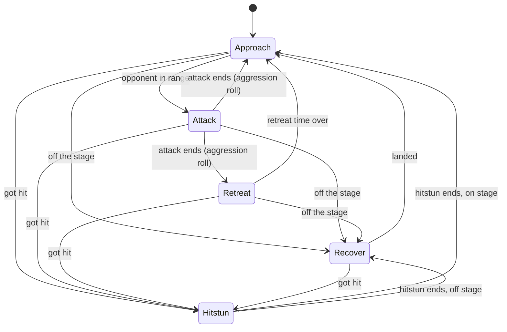

# CPU Opponent (CP4)

The CPU plays player 2 when **VS CPU** is chosen on the title screen. The code
is in `src/cpu.odin`, and its tuning is in `data/cpu.json` (F5 reloads it).

## How it plugs into the game

The CPU never moves its fighter directly. Each tick it decides which buttons
to hold and returns an `Input`, the same type the keyboard fills in for a
player. So the CPU:

- uses the same movement (walk, jump, double jump, dash, air dash, dropping
  through platforms) and the same frame data as a player
- hits and gets hit through the same collision, damage, knockback and hitstun
- can be slowed by David's Slow like anyone else, because the time scale is
  applied to the fighter and not to the CPU

The only difference from a player is where the buttons come from.

**Reaction time:** the CPU sees the opponent as they were `reaction_ticks`
ago (12 ticks = 0.2 s by default), the way a person reacts to what they saw a
moment ago. It controls its own fighter instantly, like a player does. So it
reacts to your moves late, which makes it fair and beatable, but it never
misjudges its own jumps, edges or recovery. An earlier version delayed its
button presses instead, and that caused it to overshoot edges, waste its
double jump and recover too late.

## State machine

| State | What it does |
|---|---|
| **Approach** | Moves toward the opponent (or toward a platform on the way up to them). Jumps or drops through platforms to change height, and dashes to close a long gap. Never walks off the edge of a platform. If you're standing on a platform above it, it climbs up rather than attacking from below. |
| **Attack** | Uses one attack, picked for where the opponent is: jab (very close), side strong or neutral special (ground), up air (opponent above), down air (below), forward air (in front), or a B-reversed neutral special (behind). |
| **Retreat** | Backs away for `retreat_ticks`, so it doesn't attack nonstop. |
| **Recover** | Off the stage: double jumps and air dashes back to the nearest edge. |
| **Hitstun** | Being hit: no control, so it does nothing until hitstun ends. |

Transitions:

| From | To | When |
|---|---|---|
| any state | **Hitstun** | it gets hit |
| any state except Recover | **Recover** | it's off the stage (past either side, or below the top) |
| Hitstun | **Recover** | hitstun ends while off the stage |
| Hitstun | **Approach** | hitstun ends on the stage |
| Approach | **Attack** | the opponent is in attack range |
| Attack | **Approach** | the attack ends, and a random roll is under `aggression` |
| Attack | **Retreat** | the attack ends, and the roll is over `aggression` |
| Retreat | **Approach** | `retreat_ticks` have passed |
| Recover | **Approach** | it lands on a platform |

With F2 on, the CPU's current state is shown above its head.

## Movement: steering, with waypoints for height

**Choice:** steering toward a target point. The target is usually the
opponent. If they're higher up than a jump and double jump can reach, the
target is the platform that gets the CPU closest to them on the way up
(`waypoint`). The target is picked on the ground and kept through the jump,
the way a player commits to a jump. Recovery is the same idea, with the
nearest safe point on the stage's edge as the target.

**Why steering:**

- The stage is a single screen with one main platform and three small
  platforms. There are no walls or corridors to route around. The only
  "obstacle" is height, and one rule handles that: if the opponent is out of
  jump range, go to the platform in between first.
- The opponent moves every tick, so the target changes every tick. Steering
  recalculates from scratch each tick for almost nothing. A planned path
  would be out of date as soon as it was made.
- In a platform fighter, how the CPU moves is part of how it fights (spacing,
  backing off, recovering). Steering gives that directly.

**Why not A\* or another graph search:** with four platforms, a search would
always produce the same answer the waypoint rule does, at much more cost and
complexity. It would only be worth it on a stage with many platforms, walls,
or routes where going away from the opponent is the way to reach them. This
stage has none of those.

**Why not scripted movement:** a fixed pattern ignores the player. The CPU
has to respond to where you are and what you do, or it's only a moving
obstacle.

## Tuning (`data/cpu.json`)

| Value | Effect |
|---|---|
| `reaction_ticks` | How late it sees what you do. Lower is harder. |
| `attack_range` | How close it has to be before it attacks. |
| `aggression` | 0 to 1: how often it keeps attacking instead of backing off. |
| `retreat_ticks` | How long it backs off for. |
| `dash_distance` | It dashes toward you when farther away than this. |

A harder difficulty later is just a different set of these numbers.

## Known limits

- It reacts to where you were 0.2 s ago, so a fast cross-up can make it
  attack the wrong way. That's intended: it's how a human gets fooled too.
- It doesn't shield yet (shield isn't built).
- It doesn't use openers on purpose, because openers aren't applied on hit
  yet.
